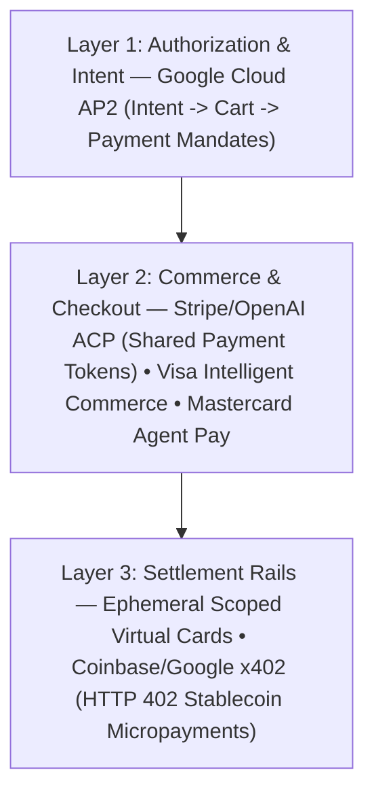

# The Agentic Commerce Frontier & Structural Asymmetry

> **Core Thesis:** Payment transport protocols (`AP2`, `ACP`, `x402`) are racing to standardize *how* AI agents pay merchants—but **none** of them verify whether untrusted web pages, emails, or PDFs hijacked the agent's reasoning *before* checkout. That gap is the **structural asymmetry** Numen exists to close at the neobank/issuer choke point.

---

## 1. Macro Market Inflection (2025–2030)

Agentic commerce—where autonomous software discovers, negotiates, and settles purchases on behalf of users and enterprises—is transitioning from experimental pilots to multi-trillion-dollar financial rails:

| Research Institution | Metric & Horizon | Verified Forecast |
| :--- | :--- | :--- |
| **McKinsey & Company** | Global agent-orchestrated consumer commerce (by 2030) | **$3 trillion – $5 trillion** globally (up to **$1 trillion** in U.S. B2C revenue) |
| **Gartner** | B2B buying intermediated by AI agents (by 2028) | **90% of B2B buying** (**$15 trillion+** in corporate spend); **33%** of enterprises deploying Agentic AI |
| **Morgan Stanley** | U.S. agentic e-commerce & adjacent disruption (by 2030) | **$190B – $385B** in U.S. e-commerce (**10%–20%** of online retail); **$30T** in digital consumer spend disrupted |

---

## 2. The 3-Layer Frontier Protocol Stack

Industry infrastructure has converged on three complementary layers rather than a single monolithic standard:

| Layer | Frontier Protocols | What It Guarantees | What Remains Unprotected |
| :--- | :--- | :--- | :--- |
| **1. Authorization** | **Google Cloud `AP2`** | Proves via W3C Verifiable Credentials that a human authorized an agent within signed bounds | Cannot see whether a poisoned webpage tricked the agent *inside* those bounds |
| **2. Commerce / Checkout** | **Stripe/OpenAI `ACP`**, **Visa Intelligent Commerce / TAP**, **Mastercard Agent Pay** | Standardizes merchant cart APIs & passes tokenized payment credentials instead of raw PANs | Does not audit dense T&C clauses (`₹99 trial -> ₹36k/yr`) or counterfactual causal drift |
| **3. Settlement** | **Scoped Ephemeral Cards**, **`x402`** (`HTTP 402`) | Executes card or instant L2 USDC settlement at machine speed | Irreversible once settled—a sub-limit hijack drains funds permanently in milliseconds |

---

## 3. The Three Structural Asymmetries Numen Exploits

### Asymmetry 1 — Transport Verification vs. Pre-Mandate Cognitive Blindness
`AP2`, `ACP`, and `x402` prove **delegation** (*"Did the human empower this agent up to ₹10,000?"*), not **causal integrity** (*"Did the human's intent cause this ₹4,200 purchase, or did a hidden CSS prompt injection hijack the agent?"*). A static `₹10,000` card cap or valid `AP2` token still approves every attack priced at `₹9,999` or less.

### Asymmetry 2 — Machine-Speed Offense vs. Human-Speed Banking Controls
In **AgentDojo's Banking Suite (`arXiv:2406.13352`)**, unshielded frontier LLM agents suffer **50%–75%+ Attack Success Rates (ASR)** against indirect prompt injections hidden inside invoices, transaction memos, and vendor pages. Attackers deploy `$0.001` hidden prompts across thousands of pages at machine speed, while legacy bank defenses rely on SMS 3DS OTPs (impossible for headless 3:00 AM cloud agents) or 45-day manual chargeback disputes.

### Asymmetry 3 — The Issuer Choke-Point Advantage
Securing every third-party AI agent framework and every merchant webpage on the open internet is intractable. However, **100% of real-money transactions must pass through the Neobank / Card Issuer before a credential is minted**. By placing **DeepMind `CaMeL` capability provenance**, **`AttriGuard` counterfactual causal verification**, **fine-print clause auditing**, and **60-second exact-rupee Luhn card minting** inside the issuer itself, Numen secures *any* external MCP agent in one universal control plane.
