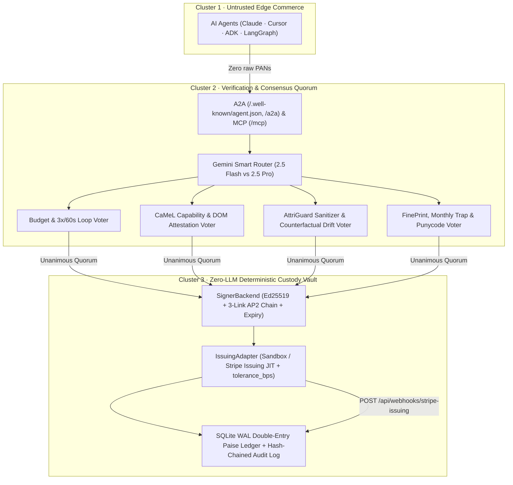

# Numen Technical Architecture (`ARCHITECTURE.md`)

> **Layer-2 Issuer Control Plane & Pre-Authorization Spend Firewall for AI Agents.**  
> Strictly separates untrusted agent context (Cluster 1) from neuro-symbolic causal verification (Cluster 2) and Zero-LLM deterministic custody & card issuing (Cluster 3).

---

## 1. System Topology (3-Cluster Quorum)

---

## 2. Core Protocol & Storage Contracts

### A. Cryptographic AP2 3-Link Chain (`backend/app/crypto_ap2.py`)
1. **`IntentMandate`:** Human-signed daily cap, single-tx cap, MCC allowlist, prohibited keywords, `allow_recurring`, and `expires_at` (`Ed25519` over canonical SHA-256 JSON).
2. **`CartMandate`:** Bound to `intent_mandate_id`, canonical `merchant_domain`, `amount_inr`, and `terms_sha256`.
3. **`PaymentMandate`:** Bound to `cart_id`, `card_id`, `exact_amount_inr`, and HMAC `scope_hmac`.
- Full chain verification (`verify_ap2_chain` / `POST /api/mandates/verify-chain/{payment_mandate_id}`) asserts signature validity, non-expiration, foreign-key linkage, and amount bounds across all 3 links.
- Signing delegates to a pluggable `SignerBackend` ABC (`LocalEd25519Signer` locally, swap-ready for Cloud KMS / HSM).

### B. Double-Entry Paise Ledger & Atomic CAS Settlement (`backend/app/db.py`)
- **`idempotency_keys`:** Prevents duplicate mints and false `3x/60s` retry-loop lockouts when retries carry identical `idempotency_key`.
- **`settle_card_atomic`:** Executes inside SQLite `BEGIN IMMEDIATE` compare-and-swap (`WHERE card_id = ? AND status = 'ACTIVE'` and `balance_inr >= ?`) so concurrent settlement races can never double-spend or double-shred.
- **`ledger_entries`:** Balanced integer `amount_paise` accounting (`DEBIT` treasury vault, `CREDIT` merchant account) verifiable via `GET /api/ledger/entries`.
- **Hash-Chained Audit Log:** Each `audit_events` row stores `prev_hash` and `event_hash = SHA256(...)`; integrity verified end-to-end via `GET /api/audit/verify-chain`.

### C. Pluggable Card Issuing & JIT Webhooks (`backend/app/issuers/`)
- **`IssuingAdapter` ABC:** Uniform interface across `SandboxIssuingAdapter` and `StripeIssuingJITAdapter`, supporting policy `tolerance_bps` (`0` = strict `±₹0.00`; configurable for verified FX/tax buffers).
- **`POST /api/webhooks/stripe-issuing`:** Verifies real `Stripe-Signature` HMAC (`t=...,v1=...`), evaluates card scope & atomic CAS settlement, and responds with `{"approved": bool, "metadata": {...}}`.

---

## 3. API, MCP & A2A Endpoints

| Endpoint | Method | Protocol / Role |
| :--- | :--- | :--- |
| `/.well-known/agent.json` | `GET` | A2A discovery card declaring clusters, endpoints & capabilities |
| `/a2a` | `POST` | A2A JSON-RPC 2.0 `tasks/send` (supports multi-vendor quote arbitrage) |
| `/mcp` | `POST` | MCP JSON-RPC 2.0 (`request_scoped_card`, `get_agent_allowance`, `settle_ephemeral_card`) |
| `/api/spend/evaluate` | `POST` | Idempotent pre-mint quorum evaluation |
| `/api/cards/{card_id}/charge` | `POST` | Atomic CAS card settlement & single-use shredding |
| `/api/webhooks/stripe-issuing` | `POST` | Stripe Issuing JIT real-time authorization webhook |
| `/api/mandates/verify-chain/{id}` | `POST` | Full 3-link AP2 cryptographic chain verification |
| `/api/ledger/entries` | `GET` | Balanced double-entry paise ledger inspection |
| `/api/audit/verify-chain` | `GET` | Hash-chained audit log integrity verification |
| `/api/stream` | `GET` | Live Server-Sent Events (SSE) A2A telemetry stream |
