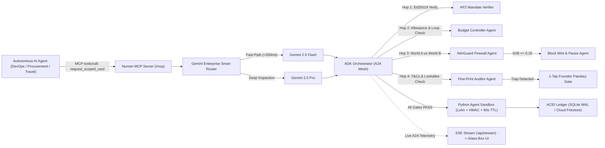
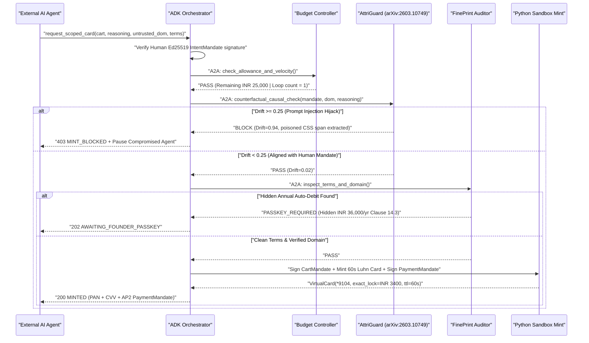

# Numen Architecture Specification

## 1. Architectural Thesis: Deterministic Safety Around Probabilistic Reasoning

Financial systems cannot execute ledger mutations or issue card PANs directly from raw LLM token output. Numen separates **semantic inspection** from **cryptographic execution** across four strict boundaries inside **Google Gemini Enterprise**:

1. **Boundary 1 — MCP Payment Interface (`mcp_server.py`):** External autonomous agents never hold raw card credentials. They invoke `request_scoped_card` over Model Context Protocol (`POST /mcp`), passing their structured cart, reasoning trace, and any untrusted external observations (webpage DOM, invoice PDF text, checkout terms).
2. **Boundary 2 — Gemini Smart Model Router (`gemini_router.py`):** Routes low-risk, whitelisted infrastructure calls with empty untrusted DOM to **`gemini-2.5-flash`** (~185 ms target latency), while escalating requests carrying untrusted HTML, long T&Cs, or unfamiliar merchants to **`gemini-2.5-pro`** for deep causal and multimodal inspection.
3. **Boundary 3 — ADK + A2A Specialist Committee (`agents/`):** Three specialized agents exchange typed `A2AMessage` envelopes streamed in real time over Server-Sent Events (`/api/stream`):
   - `BudgetControllerAgent`: Allowance, MCC allowlist, and duplicate retry-loop circuit breaker.
   - `AttriGuardAgent`: Dual DOM Sanitizer + Counterfactual Causal Drift verifier.
   - `FinePrintAuditorAgent`: Hidden recurring lock-in clause parser + lookalike domain detector.
4. **Boundary 4 — Python Agent Sandbox & ACID Ledger (`sandbox_mint.py`, `crypto_ap2.py`, `db.py`):** All Ed25519 signature verification, Luhn PAN generation, HMAC-SHA256 scope binding, 60-second TTL checks, exact-rupee settlement validation, and atomic SQLite `WAL` mutations execute deterministically in Python—never via LLM arithmetic.

---

## 2. End-to-End System Topology

---

## 3. Request Evaluation Sequence

---

## 4. Google Cloud & Gemini Enterprise Service Mapping

| Layer | Local Prototype Implementation | Production Google Cloud / Gemini Enterprise Target |
| :--- | :--- | :--- |
| **Agent Orchestration** | `agents/orchestrator.py` + `agents/a2a.py` | **Gemini Enterprise ADK** + **Agent2Agent (A2A) Protocol** |
| **Model Routing** | `gemini_router.py` (`google-genai`) | **Gemini Enterprise Gateway** (`gemini-2.5-flash` / `gemini-2.5-pro`) + Spend Caps |
| **Deterministic Execution** | `sandbox_mint.py` + `crypto_ap2.py` | **Gemini Agent Sandbox** (isolated ephemeral Ubuntu Python runtime) |
| **Policy & T&C Knowledge** | `fineprint_auditor.py` rule & regex engine | **Vertex AI RAG Engine** (Visa CE3.0 / RBI / SaaS Dark-Pattern Corpus) |
| **Cryptographic Keys** | Local Ed25519 + HMAC-SHA256 | **Google Cloud KMS** (HSM-backed signing keys) |
| **Transactional Ledger** | SQLite `WAL` mode (`db.py`) | **Cloud Firestore** (ACID transactions) + **BigQuery** (audit analytics) |
| **Compute Hosting** | Single-process FastAPI + built React SPA | **Google Cloud Run** (autoscaling containers) |

---

## 5. Failure-Mode & Invariant Guarantees

1. **Tampered Mandate Rejection:** Any 1-byte modification to an `IntentMandate` (e.g., raising `daily_limit_inr` or adding `"GIFTCARD"` to `allowed_mccs`) fails Ed25519 verification before any agent runs.
2. **Zero Post-Settlement Subscription Bleed:** As soon as a valid charge settles on a `VirtualCard`, its status transitions atomically to `SHREDDED`. Any subsequent recurring charge attempt against the same PAN is rejected with `CARD_SHREDDED`.
3. **Zero Overcharge Tolerance:** Merchant settlements verify `round(charge_amount_inr, 2) == round(card.exact_amount_inr, 2)`. Even a `+₹1.00` discrepancy is rejected with `AMOUNT_MISMATCH`.
4. **Fail-Closed Circuit Breaker:** Three identical `(agent_id, merchant_name, amount_inr)` requests within 60 seconds automatically transition the agent's status to `PAUSED`.
