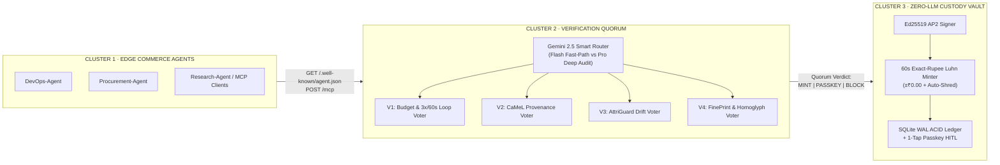

# Numen — Master Problem Statement, Research Data & Pitch Deck Brief

> **One-Sentence Product Definition:** Numen is a programmable corporate bank layer organized as a **3-Cluster Agentic Quorum** that verifies *why* an AI agent wants to buy something before minting a single-use, exact-rupee 60-second virtual card.

---

## 1. The Problem Statement (PS)

AI coding, DevOps, and procurement agents now browse untrusted vendor pages, invoices, and APIs autonomously. Yet enterprises still hand them **static corporate cards** (e.g., `₹10,000` limit) guarded only by naive `if amount <= cap` rules:

1. **Sub-Limit Indirect Prompt Injections:** Hidden CSS text (`opacity:0; font-size:0px`) on an untrusted vendor page hijacks an agent into buying `₹4,200` digital gift vouchers—strictly below the `₹10,000` limit, so static rules **blindly approve the theft**.
2. **Dark-Pattern Annual Lock-Ins:** An agent buys a `₹99` 7-day data trial whose Clause 14.3 binds a reusable corporate PAN to a non-cancellable `₹36,000/yr` renewal.
3. **Homoglyph Spoofing & Retry Storms:** Lookalike domains (`runp0d.io` instead of `runpod.io`) or gateway timeout loops drain balances before humans wake up.
4. **Why Existing Protocols Don't Fix It:** **Google Cloud AP2**, **Stripe/OpenAI ACP**, and **x402** standardize *how* payments are authorized and transported—not whether untrusted external data poisoned the agent's intent before checkout.

---

## 2. Verified Macro & Peer-Reviewed Research Data

Every claim in the Numen pitch deck floats directly on published industry and academic benchmarks:

| Source | Exact Published Metric | What It Proves for Numen |
| :--- | :--- | :--- |
| **McKinsey & Company** *(2025)* | **$3T – $5T** global agent-mediated commerce by **2030** (up to **$1T** U.S. B2C retail) | Agent-initiated spend is moving from pilots to primary commerce volume. |
| **Gartner Research** | **90%** of B2B buying & **>$15T** B2B spend intermediated by AI agents by **2028** | Enterprise finance teams need native sub-account spend governance. |
| **Google Cloud AP2** *(Sept 2025)* | **60+ → 100+** ecosystem partners (Visa, Mastercard, Stripe, PayPal, Adyen, Coinbase) | Cryptographic Intent → Cart → Payment mandates are the global standard. |
| **AgentDojo** *(arXiv:2406.13352, NeurIPS 2024)* | **629** test cases; **47.7%** overall ASR (`GPT-4o`), **33.9%** (`Claude 3.5 Sonnet`); **55.0% (`79/144`)** targeted Banking Suite ASR on undefended `gpt-4o-2024-08-06` | Frontier agents fail more than 1 in 2 banking attacks without an issuer firewall. |
| **DeepMind CaMeL** *(arXiv:2503.18813)* | Solves **77%** of AgentDojo utility tasks cleanly (vs. **84%** undefended); neutralizes **67%** of structural attacks (driving covered ASR near **0.2%**) | Control-flow (`IntentMandate`) vs. quarantined data (`DOM/T&Cs`) isolation works deterministically. |
| **Dual Tool Firewalls** *(arXiv:2510.05244, Mila / ServiceNow)* | Tool-Output Sanitizer + Tool-Input Minimizer achieves **~0% static ASR** across AgentDojo, ASB, InjecAgent & $\tau$-Bench | Stripping untrusted DOM/tool output at the MCP boundary stops known hijack strings. |
| **AttriGuard** *(arXiv:2603.10749, 2026)* | **0% static ASR** across `Llama-3.3-70B` & `Gemini` on AgentDojo with only **~3% benign utility drop** (at **~2x** token cost) | Counterfactual attribution beats semantic regex—and Numen's **Smart Router** avoids the ~2x cost on trusted fast-path calls. |

---

## 3. Solution: The 3-Cluster Agentic Architecture

Instead of one monolithic LLM making risky money decisions, Numen splits execution across three isolated clusters:

**Why 3 Clusters Beat Single-Agent Prompting:**
- **Zero-LLM Custody Air-Gap (Cluster 3):** Large language models *never* touch card PAN generation, HMAC scope hashing, Ed25519 signing, or rupee ledger debits.
- **Consensus Quorum (Cluster 2):** Spend requires unanimous pass across 4 deterministic + causal voters (`Budget/Loop`, `CaMeL`, `AttriGuard`, `FinePrint`). A single veto halts minting and auto-pauses the compromised edge agent.
- **0x Fast-Path Latency on Clean Infra:** Trusted domains with clean DOM route to `Gemini 2.5 Flash` (bypassing heavy ~2x counterfactual cost noted in `arXiv:2603.10749`), while untrusted HTML or dense clauses escalate to `Gemini 2.5 Pro`.

---

## 4. Measured Results in Live Repo (`240 Benchmarks` + `10/10 pytest`)

- **Sub-Limit Prompt Injections (`< ₹10,000`):** **100.0% (`90 / 90`)** blocked by Numen vs. **0.0%** blocked by a static `₹10,000` cap (`POST /api/benchmarks/run`).
- **Fine-Print Traps & Spoofs:** **50 / 50** annual lock-in traps flagged; **30 / 30** homoglyph domains (`runp0d.io`, `0penai.com`, etc.) blocked; **20 / 20** retry loops caught.
- **Utility & Bleed:** **0 / 50** legitimate cloud checkouts falsely blocked; **₹0.00** post-settlement bleed (`+₹1` overcharges & 2nd charges deterministically declined).
- **Pre-Filter Speed:** Deterministic pre-filter P95 `< 1 ms`; full unit + integration + tamper test suite **10 / 10 passing**.

---

## 5. Complete 9-Slide Pitch Deck Storyboard & Floating Data Plan

| Slide | Archetype | Assertion Headline | Exact Data Floated on Slide |
| :--- | :--- | :--- | :--- |
| **01** | Hero Split + Card | Verify why an agent wants to spend — before minting the card. | `₹18,40,000` Vault · `60s TTL` · `EXACT ₹3,400.00` Lock |
| **02** | Typographic KPI Strip | Agents move across `$3T–$15T` on rails where banking ASR hits `55%`. | `$3T–$5T` McKinsey · `90% / $15T` Gartner · `55.0% (79/144)` AgentDojo |
| **03** | Side-by-Side Comparison | A `₹10,000` limit approves a `₹4,200` theft unless the bank checks why. | `₹4,200 <= ₹10,000 APPROVED` vs `Drift 1.00 BLOCKED` |
| **04** | 3-Cluster Topology | A 3-Cluster Agentic Quorum separates untrusted browsing from money. | `Cluster 1 (MCP)` → `Cluster 2 (4-Voter Quorum)` → `Cluster 3 (Zero-LLM Vault)` |
| **05** | Research Evidence Table | Four peer-reviewed defenses compiled with zero fast-path bloat. | `55% ASR (2406.13352)`, `77% util/67% neut (2503.18813)`, `0% ASR (2510.05244)`, `0% ASR / ~3% drop (2603.10749)` |
| **06** | 3-Act Live Storyboard | Three live acts prove minting, hijack defense, and passkey control. | `₹3,400 -> +₹1 Fail` · `₹4,200 Hijack -> Blocked` · `₹99 -> ₹36k/yr -> Passkey` |
| **07** | Benchmark Data Bars | 100% sub-limit injection interception across 240 live scenarios. | `100.0% (90/90)` vs `0.0%` Static Cap · `₹0.00` Bleed · `0/50` False Positives |
| **08** | Live vs Production Matrix | Clear split between live sandbox/crypto and drop-in issuing rails. | `POST /mcp`, `/.well-known/agent.json`, `Ed25519`, `Stripe Issuing / RazorpayX` |
| **09** | Dark-Pine Closing | Make autonomous software safe to spend. | 4-Pillar Recap + Live Demo URL `http://127.0.0.1:8000` |
